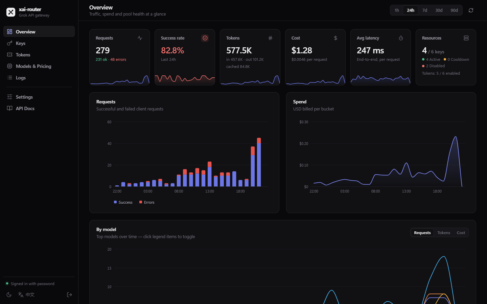
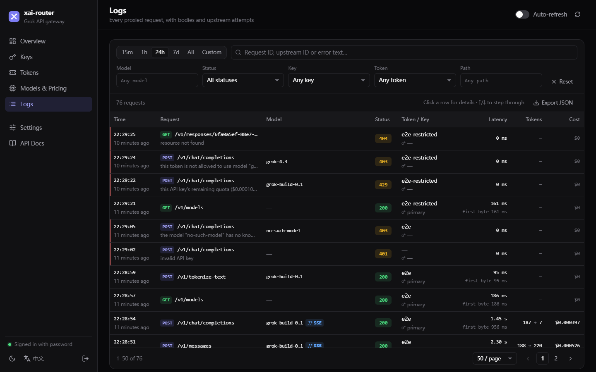
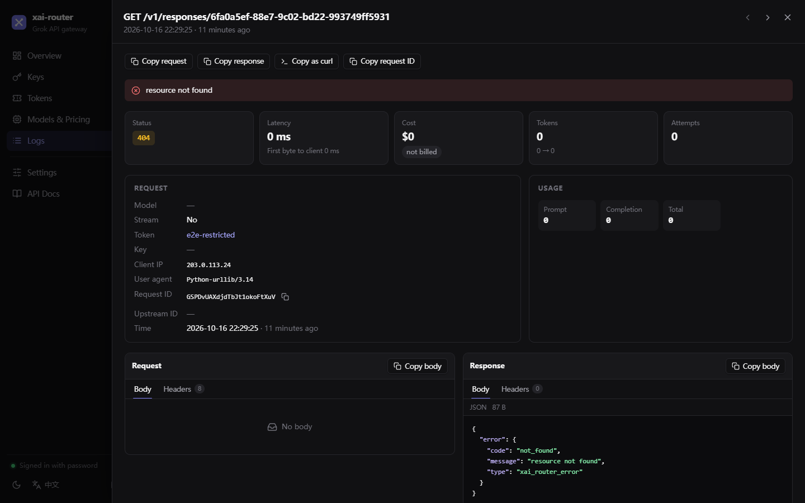
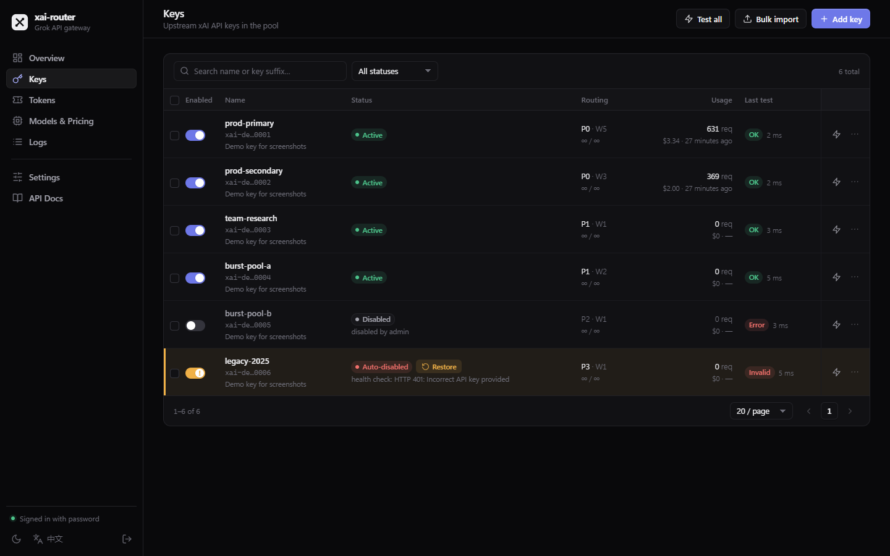
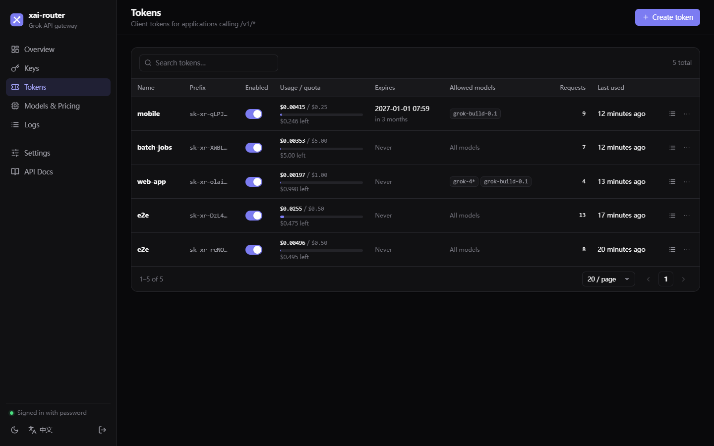
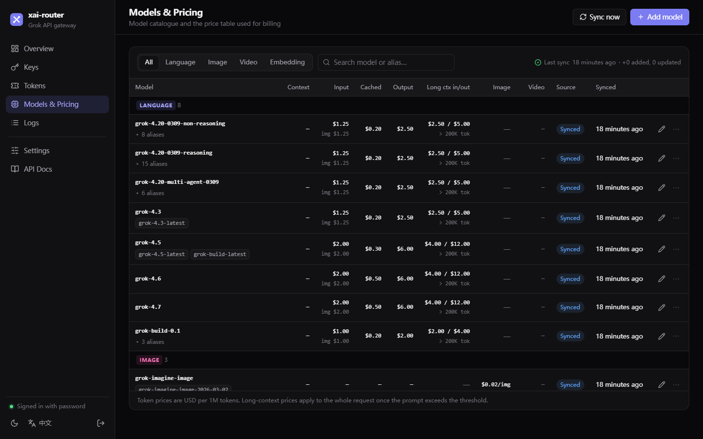
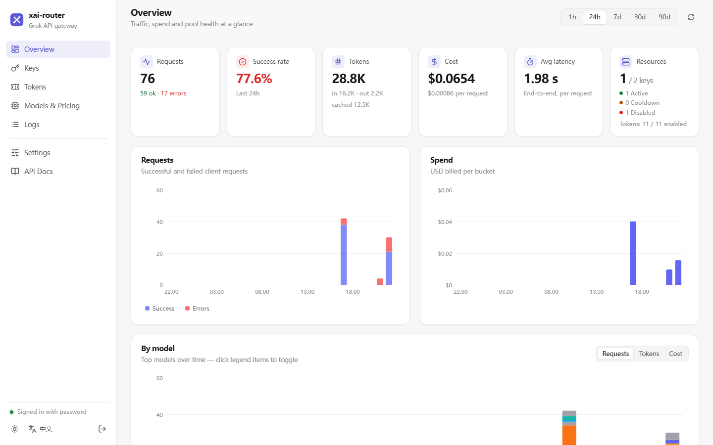

<div align="center">

# xai-router

**A fast, single-binary gateway for the xAI (Grok) API**

Key pool with failover · client tokens with quotas · exact billing · detailed request logs · modern admin console

[English](README.md) · [简体中文](README.zh-CN.md)

[](https://github.com/Kiyliy/xai-router/actions/workflows/ci.yml)
[](LICENSE)

</div>



xai-router sits between your applications and `https://api.x.ai`. Point any OpenAI- or
Anthropic-compatible client at it, hand out your own API tokens, and it routes every request
through a pool of xAI keys — retrying on another key when one is rate-limited or dead — while
recording exactly what each request cost.

It is one Go binary with an embedded SQLite database and web console. No Redis, no CGO, no
external services.

## Features

- **Transparent forwarding of the whole xAI API** — `/v1/chat/completions`, `/v1/responses`
  (including `previous_response_id`, `GET/DELETE /v1/responses/{id}`, `/compact`),
  `/v1/messages` (Anthropic-compatible, `x-api-key` accepted), images (generations, edits,
  deferred), videos (generations, extensions, edits, polling), TTS/STT, files, collections,
  batches, models, tokenize, embeddings… Unknown `/v1/*` and `/v2/*` paths are passed through
  unchanged. Server-sent events are forwarded chunk by chunk with an explicit flush.
- **WebSockets** — `/v1/realtime` (voice), streaming `/v1/tts` and `/v1/stt`, and any other
  `Upgrade` request go through the same token check, key selection and failover. Sessions are
  logged with duration, messages and bytes in each direction, close code/reason and the first
  messages, priced from the published voice rates, and closed when the token's quota runs out.
  Browsers can authenticate with the `xai-client-secret.<token>` subprotocol.
- **Key pool** — priority groups, weighted / random / round-robin selection inside a group,
  automatic failover on 401/403/429/5xx/network errors and on configurable error keywords.
  Rate-limited keys cool down (honouring `Retry-After`), repeatedly failing keys trip a circuit
  breaker, and keys that are invalid, blocked or out of credits are disabled automatically with
  the reason shown in the console (suspicious errors are confirmed with a free
  `GET /v1/api-key` first, so a client cannot get healthy keys disabled by echoing "invalid
  key" in its own input). Optional per-key concurrency and requests-per-minute limits.
- **Sticky resources** — async video/image jobs, deferred completions, stored responses, files,
  batches and collections are always accessed with the key that created them, and only by the
  client token that created them.
- **Client tokens** — issue any number of `sk-xr-…` tokens, each with a name, a USD quota, an
  expiry date, a model allow-list (aliases and `grok-4*` wildcards understood) and an on/off
  switch. Quotas are strict: every request reserves its worst-case cost before it is sent and
  settles to the real cost afterwards, so concurrent requests cannot overspend. Model lists
  (`/v1/models`, `/v1/language-models`…) only show a token's allowed models. Admin credentials
  are completely separate.
- **Exact billing** — when xAI returns `cost_in_usd_ticks` it is used as-is; otherwise the cost
  is computed from the price table: cached input, reasoning tokens, image input, the ≥200k
  long-context tier, priority processing, server-side tool calls, per-image and per-second
  media prices. All accounting is integer ticks (1 USD = 10¹⁰), so totals add up exactly.
  Models and official prices sync from xAI automatically (or on demand).
- **Key health checks** — test one key or all keys: `GET /v1/api-key` reveals blocked/disabled
  keys, `GET /v1/models` lists what the key can use, and an optional 1-token probe measures
  latency. Bulk-import keys and test them in one go.
- **Detailed request logs** — one record per client request with every upstream attempt nested
  inside (key, status, error, what the pool did, timings): method, path, masked headers, full
  request and response bodies (raw SSE for streams plus the assembled text and reasoning),
  TTFB, latency, model, token counts, cost and its source, key, token and client IP. Base64
  payloads are stripped, bodies are capped at a configurable size, and old logs are deleted
  daily. Search by time, model, status, key, token, path or request id; open any log to see
  request and response side by side, or copy it as a `curl` command.
- **Statistics per client request** — requests, success rate, tokens, cost and latency over time,
  broken down by model, key and token. Aggregates survive log retention.
- **Open admin API** — everything the console does goes through a versioned REST API
  (`/api/v1`) with a unified error format and an [OpenAPI 3 spec](web/static/openapi.yaml)
  that is also browsable inside the console.
- **Safe defaults** — a random admin password is generated (and printed once) if you do not set
  one; tokens are stored as SHA-256 hashes and compared in constant time; the request size limit
  also applies to chunked bodies; cookies and other client headers are not forwarded; the
  console has a strict CSP with no third-party scripts; debug endpoints are off by default;
  graceful shutdown lets streams finish. See [HTTPS deployment](docs/deploy-tls.md) for a
  Caddy setup with automatic certificates.

## Screenshots

| Logs | Log detail |
|---|---|
|  |  |
| **Keys** | **Tokens** |
|  |  |
| **Models & pricing** | **Light theme** |
|  |  |

## Quick start

### Docker Compose (recommended)

```bash
mkdir xai-router && cd xai-router
curl -O https://raw.githubusercontent.com/Kiyliy/xai-router/main/docker-compose.yml
docker compose up -d
docker compose logs xai-router | grep -A3 "generated an admin password"
```

Open `http://localhost:8080`, log in with the printed password, then:

1. **Keys → Import** — paste your xAI keys (one per line) and tick *Test*.
2. **Tokens → New token** — copy the `sk-xr-…` secret (shown once).
3. Use it:

```bash
curl http://localhost:8080/v1/chat/completions \
  -H "Authorization: Bearer sk-xr-..." \
  -H "Content-Type: application/json" \
  -d '{"model": "grok-4.3", "messages": [{"role": "user", "content": "Hello"}]}'
```

To build the image yourself, replace `image:` with `build: .` in `docker-compose.yml` after
cloning the repository.

### Docker Compose with HTTPS (Caddy)

For a public deployment, run Caddy next to the gateway; it gets and renews a Let's Encrypt
certificate automatically and redirects HTTP to HTTPS. Point a DNS name at the server (or use
`<ip-with-dashes>.sslip.io`), then:

```bash
mkdir xai-router && cd xai-router
curl -O https://raw.githubusercontent.com/Kiyliy/xai-router/main/docs/examples/tls/docker-compose.yml
curl -O https://raw.githubusercontent.com/Kiyliy/xai-router/main/docs/examples/tls/Caddyfile
sed -i 's/gateway.example.com/your.domain.example/' Caddyfile
docker compose up -d
```

Details, and how to add the gateway to an existing Caddy: [docs/deploy-tls.md](docs/deploy-tls.md).

### Binary

Download a release for Linux, macOS or Windows from
[Releases](https://github.com/Kiyliy/xai-router/releases), or build from source (Go 1.25+):

```bash
go build -o xai-router ./cmd/xai-router
XR_ADMIN_PASSWORD='choose-a-strong-one' ./xai-router
```

### Configuration

Only bootstrap settings are environment variables; everything else (retry rules, cooldowns,
timeouts, body limits, log retention, sync interval, trusted proxies…) is edited live under
**Settings** in the console or via `PUT /api/v1/settings`.

| Variable | Default | |
|---|---|---|
| `XR_LISTEN` | `:8080` | Listen address |
| `XR_DATA_DIR` | `./data` | Where `xai-router.db` lives |
| `XR_ADMIN_PASSWORD` | — | Initial admin password (first start only). Random if unset. |
| `XR_LOG_LEVEL` | `info` | `debug`, `info`, `warn`, `error` |
| `XR_LOG_FORMAT` | `text` | `text` or `json` |

Forgot the password? `xai-router reset-password` (or `docker compose exec xai-router
xai-router reset-password`) prints a new one and signs everyone out.

### Upgrading

Back up the data directory (or volume), then replace the binary or pull the new image and
restart (`docker compose pull && docker compose up -d`). Database migrations run automatically
on start, are idempotent, and keep all keys, tokens, logs and statistics; downgrading is not
supported.

## Using the gateway

Any OpenAI-compatible SDK works — just change the base URL and key.

```python
from openai import OpenAI

client = OpenAI(base_url="http://localhost:8080/v1", api_key="sk-xr-...")

# Chat Completions, streaming
for chunk in client.chat.completions.create(
    model="grok-4.3", stream=True,
    messages=[{"role": "user", "content": "Write a haiku about routers"}],
):
    print(chunk.choices[0].delta.content or "", end="")

# Responses API with conversation state
r1 = client.responses.create(model="grok-4.3", input="My name is Ada.")
r2 = client.responses.create(model="grok-4.3", input="What is my name?",
                             previous_response_id=r1.id)
print(r2.output_text)
```

Anthropic SDK: `Anthropic(base_url="http://localhost:8080", api_key="sk-xr-...")`.

Videos are asynchronous: `POST /v1/videos/generations` returns a `request_id`; poll
`GET /v1/videos/{request_id}`. The gateway routes every poll to the key that created the job
and bills the job once, when the finished result is returned.

WebSockets work the same way — connect to the gateway instead of `wss://api.x.ai`:

```python
import json, websocket  # pip install websocket-client

ws = websocket.create_connection(
    "wss://gateway.example.com/v1/realtime?model=grok-voice-latest",
    header=["Authorization: Bearer sk-xr-..."],
)
ws.send(json.dumps({"type": "conversation.item.create", "item": {
    "type": "message", "role": "user", "content": [{"type": "input_text", "text": "Hi"}]}}))
ws.send(json.dumps({"type": "response.create"}))
```

In a browser, where headers cannot be set, pass the token as a subprotocol:
`new WebSocket(url, ["xai-client-secret.sk-xr-..."])`.

Errors the gateway itself returns use the OpenAI shape
`{"error": {"message", "type": "xai_router_error", "code"}}`, for example `invalid_api_key`,
`insufficient_quota` (429: the request's reserved cost does not fit in the remaining quota),
`model_not_allowed`, `model_required`, `model_disabled`, `model_not_priced`,
`no_upstream_keys`. Upstream errors are returned unchanged.

## Admin API

All endpoints live under `/api/v1` and take `Authorization: Bearer <token>`, where the token is a
session from `POST /api/v1/auth/login` or a long-lived admin token (`xra-…`) created under
**Settings → Admin API tokens**. Errors always look like
`{"error": {"code": "not_found", "message": "key not found"}}`. The full specification is in
[`web/static/openapi.yaml`](web/static/openapi.yaml) and under **API Docs** in the console.

```bash
BASE=http://localhost:8080
TOKEN=$(curl -s $BASE/api/v1/auth/login -d '{"password":"..."}' | jq -r .token)
auth=(-H "Authorization: Bearer $TOKEN")

# Add keys in bulk and health-check them
curl -s "${auth[@]}" $BASE/api/v1/keys/import \
  -d '{"keys": "xai-AAA...\nbackup,xai-BBB...", "priority": 0, "test": true}'

# Create a client token: $5 quota, Grok 4 models only, expires end of year
curl -s "${auth[@]}" $BASE/api/v1/tokens \
  -d '{"name": "my-app", "quota_usd": 5, "allowed_models": ["grok-4*"], "expires_at": "2026-12-31T23:59:59Z"}'

# Failed requests in the last hour, newest first
curl -s "${auth[@]}" "$BASE/api/v1/logs?status=error&from=$(date -d '1 hour ago' +%s)"

# One log with bodies and all upstream attempts, and as a curl command
curl -s "${auth[@]}" $BASE/api/v1/logs/42
curl -s "${auth[@]}" "$BASE/api/v1/logs/42/curl?base_url=$BASE" | jq -r .curl

# Spend per model over 7 days
curl -s "${auth[@]}" "$BASE/api/v1/stats/breakdown?by=model&range=7d"

# Sync models and official prices from xAI now
curl -s "${auth[@]}" -X POST $BASE/api/v1/models/sync
```

| Area | Endpoints |
|---|---|
| Auth | `POST /auth/login`, `POST /auth/logout`, `GET /auth/me`, `PUT /auth/password` |
| Keys | `GET/POST /keys`, `GET/PATCH/DELETE /keys/{id}`, `POST /keys/import`, `POST /keys/test`, `POST /keys/{id}/test`, `POST /keys/{id}/reset` |
| Tokens | `GET/POST /tokens`, `GET/PATCH/DELETE /tokens/{id}`, `POST /tokens/{id}/regenerate` |
| Admin tokens | `GET/POST /admin-tokens`, `DELETE /admin-tokens/{id}` |
| Models | `GET/POST /models`, `PATCH/DELETE /models/{id}`, `POST /models/sync` |
| Logs | `GET/DELETE /logs`, `GET /logs/{id}`, `GET /logs/{id}/curl` |
| Stats | `GET /stats/overview`, `GET /stats/timeseries`, `GET /stats/breakdown` |
| Settings & system | `GET/PUT /settings`, `GET /system/info`, `GET /healthz` |

## How billing works

xAI reports the exact charge of every request in `usage.cost_in_usd_ticks`
(1 USD = 10,000,000,000 ticks), including cache discounts, tool calls and tier multipliers.
xai-router records that value whenever it is present (`cost_source = upstream`). When it is
missing — for example Anthropic-style streams — the cost is computed from the price table
(`cost_source = computed`):

```
input   = (prompt − cached − image) × input + cached × cached_input + image × image_input
output  = (completion + reasoning) × output
long context: if prompt ≥ 200k tokens, the long-context prices apply to the whole request
priority:     × 2 when the response says service_tier = "priority"
tools:        web search $5/1k, X posts $5/1k, X profiles $10/1k, code execution $5/1k, collections $2.50/1k
images:       per image (grok-imagine-image-2.0 by quality × resolution)
videos:       seconds × per-second price, charged once when the job finishes
voice:        no cost is reported by xAI, so the published rates are applied:
              realtime $0.08 per minute of session + $0.004 per text input,
              TTS $15 per 1M characters, STT $0.10/hour (REST) or $0.20/hour (streaming)
```

**Quotas.** Before a request is forwarded, an upper bound of its cost is reserved against the
token's quota (prompt size, `max_tokens` or 4096 output tokens plus 4096 reasoning tokens,
image count × price, video seconds × price…). If the reservation does not fit in what is left,
the request is refused with `insufficient_quota`; when it finishes, the reservation is replaced
by the actual cost. Concurrent requests therefore cannot spend more than the quota. WebSocket
sessions are charged every two seconds and closed when the quota is exhausted.

The formula was checked against live xAI responses for Chat Completions, Responses and
Messages: computed and reported costs match to the tick. Token-usage semantics differ per API
(Chat reports reasoning separately; Responses includes it in `output_tokens`; Messages excludes
cache reads from `input_tokens`) and are normalised before pricing.

## Development

```bash
go test ./...                 # unit + integration tests (mock xAI upstream)
go vet ./... && staticcheck ./...
go run ./cmd/xai-router       # http://localhost:8080
```

The console is plain HTML/CSS/JS in [`web/static`](web/static) — no framework and no build
step; it is embedded into the binary with `go:embed`.

```
cmd/xai-router     entry point, graceful shutdown, CLI
internal/proxy     /v1 forwarding, SSE, failover, resource binding
internal/pool      key selection, cooldown, circuit breaker, limits
internal/billing   usage parsing, price table, cost, model sync
internal/reqlog    async log writer, sanitising, retention
internal/keytest   key health checks
internal/admin     /api/v1 REST API
internal/store     SQLite schema and queries
test/              end-to-end tests against a mock xAI
```

## License

[MIT](LICENSE)
