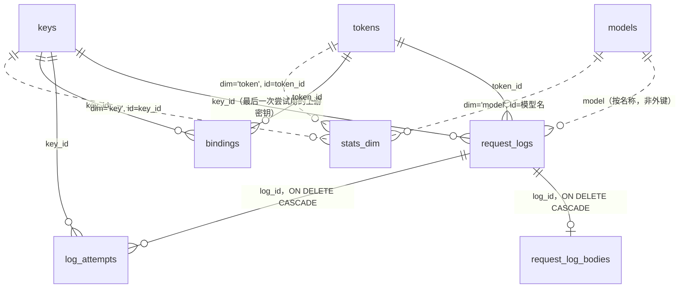

# 数据库设计

xai-router 把全部状态存在一个 SQLite 文件里（`$XR_DATA_DIR/xai-router.db`），包括：配置、上游密钥、客户端令牌、管理 API 令牌、价格表、请求日志、统计、异步任务的绑定。本文说明以下内容：

- 每张表的用途、字段和索引；
- 表之间的关系；
- 数据的生命周期和迁移方式；
- 背后的设计取舍。

本文对应 **schema v9**（v0.4.1）。独立技术评审和产品评审的结论，以及据此做的决定，见[第 10 节](#10-评审与决定)。

## 1. 术语对照

库里三种凭据是三张不同的表，物理表名和字段名沿用英文短名（见第 10 节的决定），界面和本文正文统一使用下表左起第二列的叫法。

| 表 / 字段 | 界面（中文） | 界面（English） | 管理 API 字段 |
|---|---|---|---|
| `keys` | 上游密钥 | Upstream key | `/api/v1/keys`，日志里的 `key_id` / `key_name` |
| `keys.key` | 上游密钥的值（界面只显示掩码） | key (masked) | `key_masked` |
| `keys.last_test` | 最近检测（快速检测 / 完整检测） | Last check (quick / full) | `last_test` |
| `keys.attempts` / `attempt_errors` | 尝试次数 / 失败次数 | Attempts / failed | `attempts` / `attempt_errors`（旧名 `requests` / `errors` 保留） |
| `tokens` | 客户端令牌 | Client token | `/api/v1/tokens`，日志里的 `token_id` / `token_name` |
| `tokens.token_hash` / `prefix` | 令牌值（只存 hash）/ 令牌前缀 | token value / prefix | `prefix`（令牌值只在创建或重新生成时返回一次） |
| `tokens.quota_ticks` / `used_ticks` | 额度 / 额度已用 | Quota / quota used | `quota_usd` / `used_usd` |
| `tokens.used_ticks + reset_ticks` | 累计花费 | Total spend | `spent_usd` |
| `events` | 事件日志（操作 / 系统） | Event log (operation / system) | `/api/v1/events` |
| `admin_tokens` | 管理 API 令牌 | Admin API token | `/api/v1/admin-tokens` |
| `sessions` | 控制台登录会话 | Console session | — |
| `request_logs` | 请求日志 | Request logs | `/api/v1/logs` |
| `log_attempts` | 上游尝试 | Upstream attempts | `upstream_attempts` |
| `stats_dim` | 统计（概览、明细） | Statistics | `/api/v1/stats/*` |
| `*_ticks` | 金额（界面显示美元） | cost (USD) | `*_usd` |

## 2. 约定

| 项目 | 约定 |
|---|---|
| 主键 | 自增整数 `id`（`INTEGER PRIMARY KEY AUTOINCREMENT`，id 不复用，所以统计和日志里的 id 永远不会指到别的对象）。天然有唯一键的表，直接用它做主键（`models.id` 是模型名，`bindings.resource_id` 是上游资源 id） |
| 时间 | `*_at` 字段都是 **Unix 毫秒**（`INTEGER`，UTC），0 表示"没有"（例如 `expires_at = 0` 表示永不过期）。统计的 `hour` 是该小时起点的 Unix 毫秒（UTC 整点）。库里不存时区；按天的图表在查询时按浏览器的时区偏移分桶 |
| 金额 | `*_ticks` 字段都是 `INTEGER` 的 tick：**1 美元 = 10¹⁰ tick**，这是 xAI 自己的计费单位（`cost_in_usd_ticks`）。库里没有浮点金额，只在 API 输出时换算成美元 |
| 价格 | 文本模型的 token 价格是"每 token 多少 tick"（1 美元 / 百万 token = 10,000 tick/token）；图片按张，视频按秒 |
| 布尔 | `INTEGER` 0/1 |
| 列表和对象 | JSON 文本（`TEXT`），例如 `aliases`、`allowed_models`、`image_tiers`，空值为 `'[]'` 或 `'{}'` |
| "没有" | 文本 `NOT NULL DEFAULT ''`；时间、计数 `DEFAULT 0`。可能为空的外部 id：日志和尝试记录的 `token_id`、`key_id` 用 NULL，`bindings.token_id` 用 NULL，`stats_dim` 里无令牌记作 `'0'` |
| 删除 | 上游密钥和客户端令牌**软删除**（`deleted_at > 0`），其余对象硬删除 |
| 连接 | WAL 模式；1 个写连接 + 只读连接池；`foreign_keys=ON`；`busy_timeout=10s`；`synchronous=NORMAL`；新库 `auto_vacuum=INCREMENTAL` |

## 3. 表一览

| 表 | 用途 | 规模（参考） |
|---|---|---|
| `schema_version` | 当前 schema 版本号（一行） | 1 行 |
| `meta` | 键值配置：运行设置（JSON）、管理员密码 hash、初始密码标记、上次模型同步结果 | 几行 |
| `keys` | 上游密钥 | 几到几百 |
| `tokens` | 客户端令牌（应用调用 `/v1/*` 用） | 几到几千 |
| `admin_tokens` | 管理 API 令牌（脚本调用 `/api/v1/*` 用） | 几个 |
| `sessions` | 控制台登录会话 | 几个 |
| `models` | 模型目录和价格表 | 几十 |
| `request_logs` | 每个客户端请求一行：摘要、Token 数、费用 | 百万级 |
| `request_log_bodies` | 请求和响应的头、正文（与摘要分开存） | 与日志同量，占体积的大头 |
| `log_attempts` | 每次上游尝试（一个请求可能换上游密钥重试多次） | 约等于日志条数 |
| `bindings` | 上游资源与创建它的上游密钥、客户端令牌之间的绑定。资源包括异步视频/图片任务、已存的 response、文件、批处理等 | 随异步任务量 |
| `stats_dim` | 按小时预聚合的统计，分 4 个维度：全部 / 模型 / 上游密钥 / 客户端令牌 | 每小时最多 1 + 模型数 + 上游密钥数 + 客户端令牌数 行 |
| `events` | 事件日志：管理员做了什么（operation）、网关自己做了什么（system）。只能追加，永久保留 | 每天几十到几百行 |

## 4. 关系图

数据库层面的外键只有两个：`request_log_bodies.log_id` 和 `log_attempts.log_id`，删日志时级联删除。

`request_logs`、`log_attempts`、`bindings` 里的 `key_id`、`token_id` **故意不设外键**。删掉一个上游密钥或客户端令牌之后，历史日志、统计和账目都必须保留，所以：
- 上游密钥和客户端令牌本身是软删除；
- 日志里还冗余存了 `key_name`、`token_name`、`token_prefix`。

删除行为见[第 7 节](#7-删除行为)。

## 5. 各表字段

### 5.1 `keys`（上游密钥）

| 字段 | 类型 | 约束 / 默认 | 含义 |
|---|---|---|---|
| id | INTEGER | PK 自增 | |
| name | TEXT | NOT NULL | 显示名，不要求唯一 |
| key | TEXT | NOT NULL UNIQUE | xAI API key 明文。转发时要用，所以只能存明文；API 和界面只返回掩码。软删除后改写为 `deleted:<id>:<掩码>`，明文不再保留 |
| base_url | TEXT | NOT NULL | 上游地址，默认 `https://api.x.ai`，受 SSRF 策略限制 |
| priority | INTEGER | 0 | 优先级组，数字小的先用 |
| weight | INTEGER | 1 | 组内权重 |
| enabled | INTEGER | 1 | 管理员开关 |
| auto_disabled | INTEGER | 0 | 网关判定失效后自动禁用。与 `enabled` 分开存，"恢复"时不改管理员的设置 |
| status_reason | TEXT | '' | 自动禁用或冷却的原因 |
| cooldown_until | INTEGER | 0 | 冷却到期时间 |
| max_concurrency / rpm_limit | INTEGER | 0 | 并发上限、每分钟请求上限，0 = 不限 |
| attempts / attempt_errors | INTEGER | 0 | 用这个上游密钥做过的**上游尝试**次数和失败次数。一个客户端请求可能先后尝试多个上游密钥，所以这两个数和统计里"按上游密钥"的请求数口径不同（v8 前叫 `requests` / `errors`） |
| cost_ticks | INTEGER | 0 | 记到这个上游密钥上的花费（随日志写入累加） |
| last_used_at | INTEGER | 0 | |
| last_error | TEXT | '' | 最近一次错误 |
| last_test / last_tested_at | TEXT / INTEGER | '' / 0 | 最近一次检测结果（JSON）和时间 |
| notes | TEXT | '' | 备注 |
| created_at / updated_at | INTEGER | NOT NULL | |
| deleted_at | INTEGER | 0 | 软删除时间，0 = 未删除（v8） |

### 5.2 `tokens`（客户端令牌）

| 字段 | 类型 | 约束 / 默认 | 含义 |
|---|---|---|---|
| id | INTEGER | PK 自增 | |
| name | TEXT | NOT NULL | 不要求唯一，界面用"名称 · 前缀"区分 |
| token_hash | TEXT | NOT NULL UNIQUE | 令牌值的 SHA-256（hex）。**不存明文**，令牌值只在创建或重新生成时返回一次。软删除后改写为 `deleted:<id>`，令牌立即失效 |
| prefix | TEXT | NOT NULL | 令牌值的前几位（`sk-xr-xxxx`） |
| enabled | INTEGER | 1 | |
| quota_ticks | INTEGER | 0 | 额度，0 = 不限 |
| used_ticks | INTEGER | 0 | **额度已用**，用来判断额度够不够。从 v0.4.1 起不再提供"重置用量"，额度只能通过调整（见 5.9）增减 |
| reset_ticks | INTEGER | 0 | v0.4.0 时"重置用量"清掉的金额之和（v8，之后不再写入）。`used_ticks + reset_ticks` = 累计花费 |
| used_reset_at | INTEGER | 0 | v0.4.0 时最近一次重置用量的时间（v8，之后不再写入） |
| expires_at | INTEGER | 0 | 0 = 永不过期 |
| allowed_models | TEXT | '[]' | 模型白名单（JSON 数组，支持别名和 `grok-4*` 通配），空 = 全部 |
| requests / last_used_at | INTEGER | 0 | 计数器 |
| notes | TEXT | '' | |
| created_at / updated_at | INTEGER | NOT NULL | |
| deleted_at | INTEGER | 0 | 软删除时间（v8） |

### 5.3 `admin_tokens`、`sessions`

| 表.字段 | 类型 | 含义 |
|---|---|---|
| admin_tokens.id / name / prefix | | 管理 API 令牌（`xra-…`） |
| admin_tokens.token_hash | TEXT UNIQUE | SHA-256，不存明文；吊销即删除这一行 |
| admin_tokens.last_used_at / created_at | INTEGER | |
| sessions.token_hash | TEXT PK | 控制台会话令牌的 SHA-256 |
| sessions.created_at / expires_at / last_seen_at | INTEGER | 30 天滑动过期 |

### 5.4 `models`（模型目录与价格）

| 字段 | 类型 | 默认 | 含义 |
|---|---|---|---|
| id | TEXT PK | | 模型名，例如 `grok-4.3` |
| kind | TEXT | | language / image / video / embedding |
| aliases | TEXT | '[]' | 别名（JSON） |
| enabled | INTEGER | 1 | 停用后，用这个模型的请求直接拒绝 |
| source | TEXT | 'builtin' | builtin / sync / manual。手动改过的模型（manual）不会被同步覆盖 |
| context_length | INTEGER | 0 | |
| input_ticks / cached_ticks / output_ticks | INTEGER | 0 | 每 token 价格（tick） |
| image_token_ticks | INTEGER | 0 | **每个图片输入 token** 的价格（v8 前叫 `image_input_ticks`，容易和下面的 `input_image_ticks` 混淆） |
| long_threshold, long_input_ticks, long_cached_ticks, long_output_ticks | INTEGER | 0 | 长上下文档：prompt ≥ 阈值时，整个请求按这一档计价 |
| image_ticks | INTEGER | 0 | 每张生成图片的基础价（列出的默认档价格）。请求的档位没有匹配时，按最高档计 |
| image_tiers | TEXT | '[]' | `[{quality, resolution, ticks}]`，每张 |
| video_ticks_per_sec | INTEGER | 0 | 视频每秒基础价 |
| video_tiers | TEXT | '[]' | `[{resolution, ticks}]`，每秒（v5） |
| input_image_ticks | INTEGER | 0 | **每张输入图片**的价格，用于图片编辑、图生视频、参考图（v5） |
| input_video_ticks_per_sec | INTEGER | 0 | 每秒输入视频的价格，用于视频编辑（v5） |
| raw | TEXT | '' | 同步时上游返回的原始 JSON，方便排查价格问题 |
| synced_at / updated_at | INTEGER | | |

### 5.5 `request_logs`（请求日志摘要）

每个客户端请求一行。成功、失败、被网关拒绝、客户端中途断开，都会记一行。

| 字段 | 类型 | 默认 | 含义 |
|---|---|---|---|
| id | INTEGER PK 自增 | | 同时是列表的次排序键 |
| request_id | TEXT | | 网关生成的请求 id（响应头 `X-Request-Id`） |
| created_at | INTEGER | | 请求**开始**时间（行在请求结束时写入） |
| method / path / query | TEXT | | |
| model | TEXT | '' | |
| stream / ws | INTEGER | 0 | 是否流式 / 是否 WebSocket |
| status | INTEGER | 0 | 返回给客户端的状态码。499 = 客户端断开 |
| error | TEXT | '' | 错误说明（上游尝试的错误截断到 2000 字符，WebSocket 的截断到 500 字符） |
| client_ip / user_agent | TEXT | '' | |
| token_id / token_name / token_prefix | INTEGER NULL / TEXT / TEXT | | 客户端令牌。名称和前缀是请求当时的值（`token_prefix` 从 v8 开始写入；更早的行显示令牌当前的前缀） |
| key_id / key_name | INTEGER NULL / TEXT | | 最后一次尝试用的上游密钥 |
| attempts | INTEGER | 0 | 上游尝试次数（详情在 `log_attempts`） |
| ttfb_ms / latency_ms | INTEGER | 0 | 首包耗时、总耗时 |
| prompt_tokens, completion_tokens, cached_tokens, reasoning_tokens, image_tokens, total_tokens | INTEGER | 0 | 统一口径后的 Token 数 |
| images / video_seconds | INTEGER / REAL | 0 | 媒体用量。视频秒数可能有小数，它只是用量，不是金额 |
| cost_ticks | INTEGER | 0 | 本请求的费用 |
| cost_source | TEXT | 'none' | upstream（上游返回）/ computed（按价格表算）/ estimated（响应被截断时估算）/ none |
| upstream_id | TEXT | '' | 上游返回的 id（response id、任务 id 等） |
| truncated | INTEGER | 0 | 正文是否被截断 |
| extra | TEXT | '' | WebSocket 会话等的附加信息（JSON，v2） |

### 5.6 `request_log_bodies`、`log_attempts`

| 表.字段 | 含义 |
|---|---|
| request_log_bodies.log_id | PK，外键 → request_logs.id，ON DELETE CASCADE |
| req_headers / resp_headers | 请求头和响应头（JSON，Authorization 等已脱敏） |
| req_body / resp_body | 正文（base64 媒体已剥离，超过上限会截断；流式响应存原始 SSE） |
| resp_text / reasoning_text | 拼好的回答全文和推理文本 |
| log_attempts.id | PK 自增 |
| log_attempts.log_id | 外键 → request_logs.id，ON DELETE CASCADE |
| seq, key_id, key_name, status, error, action, ttfb_ms, latency_ms, started_at | 第几次尝试、用的上游密钥、结果，以及网关采取的动作（retry / cooldown / disable / success / return） |

### 5.7 `bindings`（资源绑定）

| 字段 | 类型 | 含义 |
|---|---|---|
| resource_id | TEXT PK | 上游资源 id |
| kind | TEXT | video / image / deferred / response / file / batch / collection |
| key_id | INTEGER NOT NULL | 后续请求必须用的上游密钥 |
| token_id | INTEGER NULL | 只有这个客户端令牌能访问这个资源 |
| model | TEXT | |
| billed | INTEGER | 异步任务是否已计费，保证只计一次 |
| price_meta | TEXT | 提交时的计价参数，例如分辨率、输入图张数（JSON，v5） |
| created_at / expires_at | INTEGER | 默认 720 小时后过期 |

写入先进内存缓存，再由后台按顺序落库，所以请求不用等 SQLite 的写锁；读取时先查内存。例外是"标记已计费"：它同步写库（每个任务只写一次），这样进程在计费后立即崩溃，重启后也不会再计一次。

### 5.8 `stats_dim`（小时级预聚合统计）

| 字段 | 类型 | 含义 |
|---|---|---|
| dim | TEXT | `all` / `model` / `key` / `token` |
| hour | INTEGER | 小时起点（Unix 毫秒，UTC） |
| id | TEXT | 维度值：`''`（all）、模型名、上游密钥 id、客户端令牌 id（`'0'` = 无令牌） |
| requests, success, errors | INTEGER | 客户端请求数（不是上游尝试数） |
| prompt_tokens … total_tokens | INTEGER | |
| cost_ticks | INTEGER | |
| latency_ms_sum | INTEGER | 耗时之和，用来算平均耗时 |
| | | PK (dim, hour, id)，`WITHOUT ROWID` |

每批日志写入时，在**同一个事务**里对 4 个维度做 upsert。关闭"记录日志"、或者某条日志写入失败只能记账时，统计照样累加，所以统计是计费的权威来源；日志会过期删除，统计不会。

### 5.9 `events`（事件日志，v9）

| 字段 | 类型 | 含义 |
|---|---|---|
| id | INTEGER PK 自增 | |
| created_at | INTEGER | 发生时间（Unix 毫秒） |
| kind | TEXT | `operation`（管理员操作）/ `system`（网关自动行为） |
| action | TEXT | 例如 `key.update`、`token.quota_adjust`、`key.auto_disable`、`logs.retention`、`disk.low` |
| actor / actor_name | TEXT | `password` / admin；`admin_token:<id>` / 令牌名；`system` |
| target_type / target_id / target_name | TEXT | 被操作对象；名称在操作当时解析（删除前） |
| ip | TEXT | 管理员的客户端 IP |
| detail | TEXT | JSON：请求字段（`key`、`password`、`token` 等密文一律写成 `[redacted]`），或该事件特有的数据（额度调整的前后金额、清理的条数等） |

- **只能追加**：两个触发器拒绝任何 `UPDATE` 和 `DELETE`，所以连网关自己也改不了历史；**永久保留**，不受日志保留天数和手动清理影响。
- **记录什么**：管理 API 每一次成功的写操作（由中间件统一记录）和登录；系统事件只记状态变化，不记高频事件。例如上游密钥只在"变成自动禁用"的那一刻记一条，冷却不记；模型同步只在价格变化或失败时记；磁盘告警每越过一次阈值记一条。
- **额度调整**：客户端令牌的额度在创建时设定，之后只能用 `POST /api/v1/tokens/{id}/quota` 增减（或改为不限额度）。额度的修改和对应的 `token.quota_adjust` 事件在**同一个事务**里写入，事件 detail 里有调整前后的 tick 数和备注，所以额度不可能"没有记录地改变"。
- 索引：`(created_at)`、`(kind, created_at)`、`(target_type, target_id, created_at)`，分别服务全量列表、按类型筛选、某个对象的历史（例如令牌的额度记录）。

## 6. 索引与它服务的查询

`request_logs` 的列表接口按 `(created_at DESC, id DESC)` 排序。验收要求是 300 万条日志下任意筛选组合 p95 < 500ms；实测（`notes/xai-router-evidence/P1-P2-bench.md`）所有列表查询 p95 都低于 200ms。

查询方式：
- 分页时先只查 id，再按 id 取整行；
- 总数先在 250ms 的预算内精确计数，超时就用 `stats_dim` 估算，估算值不超过剩余日志的 id 范围。

筛选条件包含模型、上游密钥或客户端令牌时，查询显式使用该维度的覆盖索引（`INDEXED BY`）。原因：SQLite 不收集统计信息，和状态筛选组合时，它会选更大的状态索引，再为每条匹配读一次宽行。

| 索引 | 列 | 服务的查询 |
|---|---|---|
| idx_logs_created | (created_at) | 不带筛选的列表、时间范围、深分页、按时间清理 |
| idx_logs_model_f | (model, created_at, key_id, token_id, status, path) | 按模型筛选，以及模型加其他条件的组合（覆盖索引，不读宽行） |
| idx_logs_key_f | (key_id, created_at, token_id, model, status, path) | 按上游密钥筛选及组合 |
| idx_logs_token_f | (token_id, created_at, key_id, model, status, path) | 按客户端令牌筛选及组合 |
| idx_logs_status | (status, created_at) | 精确状态码（例如 429） |
| idx_logs_ok | ((成功表达式), created_at) | 只看成功 / 只看失败 |
| idx_logs_class | ((status/100), created_at) | 4xx / 5xx |
| idx_logs_path | (path, created_at) | 路径前缀 |
| idx_logs_reqid | (request_id) | 按请求 id 搜索 |
| idx_logs_upstream | (upstream_id) | 按上游 id 搜索 |
| idx_logs_errsearch | (created_at, id, error, model, key_id, token_id, status, path) WHERE error <> '' | 错误文本搜索（只扫失败的请求，并覆盖其他筛选列） |
| idx_attempts_log | log_attempts(log_id) | 日志详情读取尝试记录；级联删除 |
| idx_bindings_expires | bindings(expires_at) | 清理过期绑定 |
| 各表的 UNIQUE | keys.key、tokens.token_hash、admin_tokens.token_hash | 导入去重、按 hash 鉴权 |

统计查询只读 `stats_dim` 的主键范围（`dim = ? AND hour >= ?`），与日志量无关。

写入成本：每条日志大约要更新 20 个 B 树，包括 `request_logs` 的 12 个、正文表、尝试记录、4 个统计维度和两张计数表，批量写入。在 160 请求/秒、20 并发下，网关的额外延迟 p99 约 2ms（`notes/xai-router-evidence/P3-P4-load-final.md`）。不要再加日志索引。

## 7. 删除行为

| 删除对象 | 日志 | 尝试记录 | 统计 | 绑定 |
|---|---|---|---|---|
| 一条日志（过期或手动清理） | — | 级联删除 | **保留**（统计不随日志删除） | 不受影响 |
| 上游密钥（软删除） | 保留，照常显示"名称 · 掩码" | 保留 | 保留，明细里标"已删除" | 保留到过期。绑定到这个上游密钥的资源返回 503 `upstream_key_unavailable` |
| 客户端令牌（软删除） | 保留，照常显示"名称 · 前缀" | — | 保留，明细里标"已删除" | 保留到过期。资源只属于原令牌，其他令牌访问返回 404 |
| 管理 API 令牌（吊销） | — | — | — | — |

软删除的效果：
- 对象立即从上游密钥池、鉴权和所有列表里消失；
- 上游密钥的明文被覆盖，可以重新添加同一个 key；
- 客户端令牌的 hash 被覆盖，令牌立即失效；
- 行本身保留，所以名称、前缀或掩码、累计花费都还在。

v0.4.0 之前硬删除的对象，在统计里显示为"#id（已删除）"。

### 7.1 冗余字段与对账

以下字段是冗余的，都在写日志的同一事务里更新，用于快速显示：

- `keys.attempts`、`keys.attempt_errors`、`keys.cost_ticks`；
- `tokens.requests`、`tokens.used_ticks`；
- `stats_dim`；
- 日志里的 `key_name`、`token_name`、`token_prefix`。

**花费和账单以 `stats_dim` 为准**。统计永久保留，并且包含没有记录日志的请求；日志只在保留期内可以对照。对账关系：

- 统计费用之和 = 所有客户端令牌的 `used_ticks + reset_ticks` 之和（含已删除的令牌）+ 没有令牌的请求的费用；
- 统计中"按上游密钥"的费用之和 = 统计总费用。各上游密钥的 `cost_ticks` 按上游尝试记账，用于显示该密钥自己的花费。

`tokens.used_ticks` 同时是额度判断的依据。启动时从库里加载，运行时由额度模块在内存中预扣和结算。

## 8. 数据生命周期

| 数据 | 保留多久 | 由谁清理 |
|---|---|---|
| 请求日志（含正文、尝试记录） | 默认 30 天（`log_retention_days`，0 = 永久） | 后台清理在启动 1 分钟后执行第一次，之后每小时一次；按小步删除（每步持写锁约 10ms），每次执行都记一条 `logs.retention` 事件。也可以在"数据与存储"页按日期手动清理（后台任务，有进度和预估条数） |
| 统计 `stats_dim` | **永久**。每小时最多几十行，一年约几十万行 | 不清理 |
| 绑定 | 默认 720 小时（`task_binding_ttl_hours`） | 后台清理 |
| 控制台会话 | 30 天滑动过期 | 后台清理 |
| 上游密钥、客户端令牌 | 永久；删除是软删除，行保留 | — |
| 事件日志 `events` | **永久**，只能追加 | 不清理（触发器禁止删除） |
| 模型、设置、管理 API 令牌 | 永久，直到手动删除或吊销 | — |

**磁盘是真正的约束。** 旧项目线上 105 天产生了 766 万条日志（峰值每小时约 2.6 万条，约 7 次写入/秒，其中 90% 是失效 key 重试产生的 403），SQLite 的写入能力有 100 倍以上的余量；日志体积才是上限。对应的措施：

- 请求体和响应体分别有单条大小上限：`log_request_body_max_kb`、`log_response_body_max_kb`，默认各 32KB（v0.4.1 之前是共用的 256KB）；拼好的回答文本也受响应上限约束；base64 媒体一律剥离。
- 换上游密钥重试的中间尝试是挂在这条日志下的 `log_attempts` 子行，不会产生新的 `request_logs` 行；每个请求的尝试次数受 `max_attempts`（默认 5）限制，失效的 key 会被自动禁用，之后不再被尝试。
- 系统信息里显示数据盘的总量、剩余和使用率；超过 `disk_warn_percent`（默认 85%）时控制台顶部显示横幅，并记一条 `disk.low` 事件（每 10 分钟检查一次，越过阈值才记）。

磁盘空间回收：新库是 `auto_vacuum=INCREMENTAL`，删除后的空闲页会被新日志复用；需要把空间还给系统时，在"数据与存储"页执行"压缩"（分小步执行，空闲空间很大时可能需要几个小时）。v0.3 之前创建的库，需要在"数据与存储"页执行一次"压缩"，转成增量模式。这一次是完整的 VACUUM，期间会阻塞写入。

## 9. 迁移

- 版本号存在 `schema_version`（一行）。启动时按顺序执行 `internal/store/db.go` 里的 `migrations[v:]`。
  - 每个版本在**一个事务**里执行，并在同一事务里更新版本号。中途失败会整体回滚，下次启动重试，所以重复启动是安全的。
  - 数据库的版本比程序新时（例如降级运行旧版本），程序拒绝启动，避免旧代码把软删除的令牌当成有效令牌。
- **已发布的迁移不再修改**，结构变更都通过新版本完成。
- 大表（`request_logs`、正文、尝试记录）只做两类改动：
  - 加列（`ADD COLUMN … DEFAULT`，SQLite 中是 O(1)）；
  - 先建新索引再删旧索引，避免中间出现没有索引的窗口。
- 不在大表上做需要重建表的改动（加 CHECK、外键、去掉 UNIQUE）。在 300 万条日志上，每建一个索引都要在启动时占用写锁几十秒。

| 版本 | 发布 | 内容 |
|---|---|---|
| v1 | v0.1.0 | 初始 schema：meta、keys、tokens、admin_tokens、sessions、models、request_logs、request_log_bodies、log_attempts、bindings、stats_hourly |
| v2 | v0.2.0 | 日志加 `ws`、`extra`（WebSocket 会话） |
| v3 | v0.3.0 | 新统计表 `stats_dim`，从 `stats_hourly` 回填后清空旧表；日志加成功/失败、状态类别、路径、上游 id 索引 |
| v4 | v0.3.0 | 失败请求的部分索引，用于错误文本搜索 |
| v5 | v0.3.0 | 模型加 `video_tiers`、`input_image_ticks`、`input_video_ticks_per_sec`；绑定加 `price_meta` |
| v6 | v0.3.0 | 错误文本搜索的覆盖索引 `idx_logs_errsearch`，替换 v4 的索引 |
| v7 | v0.3.0 | 模型、上游密钥、客户端令牌三个索引改为覆盖其他筛选列（`*_f`），替换旧的单列索引 |
| v8 | v0.4.0 | 以下改动依据第 10 节的评审：上游密钥和客户端令牌加 `deleted_at`（软删除）；令牌加 `reset_ticks`、`used_reset_at`；`keys.requests/errors` 改名为 `attempts/attempt_errors`；`models.image_input_ticks` 改名为 `image_token_ticks`；日志加 `token_prefix`；删除空表 `stats_hourly` |
| v9 | v0.4.1 | 事件日志表 `events`（只能追加的触发器）。同版本的代码改动：额度只能调整并留记录，去掉重置用量；请求体 / 响应体分别设上限 |

升级测试：
- `store.TestUpgradeFromV010Schema`：用 v0.1.0 的 schema 和数据升级到最新版本，核对数据，并验证重复启动不会出错；
- `store.TestUpgradeFromV031Schema`：用 v0.3.1（v7）的数据库升级，核对以下几点：
  - 改名后的列保留原值，旧表已删除；
  - 软删除、重置用量和名称/前缀解析在旧数据上都正确；
  - 令牌累计花费仍等于日志费用；
  - 删除后可以重新添加同一个上游密钥；
  - 数据库版本比程序新时拒绝启动。

## 10. 评审与决定

v0.4.0 前对 v7 做了两轮评审：
- 独立技术评审：子 agent 读完全部迁移和查询，并在 20 万行的副本上用 `EXPLAIN QUERY PLAN` 验证索引；
- 产品评审：产品经理逐项核对 schema 能否支撑界面方案（`notes/xai-router-pm-spec.md` 第 7 节）。

两边的问题以及处理结果如下。意见不一致时，以正确性和简单为准，由技术负责人决定。

### 10.1 已修复（v8 或代码）

| 来源 | 问题 | 处理 |
|---|---|---|
| 技术 H1 | 按客户端令牌、上游密钥或模型筛选再加状态筛选时，查询走状态索引，并为每条匹配读一次宽行；精确计数接近全表扫描 | 有维度筛选（且不是文本搜索）时，显式使用该维度的覆盖索引。实测"模型 + 失败"从 256ms 降到 33ms，"令牌 + 成功""上游密钥 + 失败"都在 50ms 以内 |
| 技术 H2 + 产品建议 1 | 硬删除令牌或上游密钥、"重置用量"都会让令牌已用之和对不上日志和统计；删除后历史记录分不清同名对象 | 软删除（`deleted_at`，并覆盖明文 key 和令牌 hash）；重置时把清掉的金额记入 `reset_ticks`，并记录 `used_reset_at` |
| 产品必须 2 | "额度已用"和"累计花费"是两个数 | `used_ticks` 定义为额度已用，`used_ticks + reset_ticks` 为累计花费。API 增加 `spent_usd` 和 `used_reset_at`；界面分别显示两个数。账单以 `stats_dim` 为准（第 7.1 节） |
| 产品必须 1 | 文档正文中英混用，对不上界面 | 第 1 节加术语对照表，正文统一使用界面叫法 |
| 技术 M1 | `image_input_ticks`（每图片 token）和 `input_image_ticks`（每张输入图）只差一个词序，写错会差几个数量级 | 列改名为 `image_token_ticks`。管理 API 字段 `image_input_price` 不改（公开接口，避免破坏已有脚本），文档注明它的含义 |
| 技术 M2 | `keys.requests/errors` 实际统计的是上游尝试次数，和统计里的请求数永远对不上 | 列改名为 `attempts/attempt_errors`，API 同时返回新旧两个名字；对账以统计为准（第 7.1 节） |
| 技术 M3 | "已计费"标记走后台异步写，崩溃后重启可能重复计费 | 这一个写入改为同步 |
| 技术 M4 | 旧版本程序打开新版本数据库时不会报错 | 拒绝启动并提示升级 |
| 产品建议 2 | 重新生成令牌值后，旧日志会显示新前缀 | 日志加 `token_prefix`，写入请求当时的前缀 |
| 技术 Low + 产品建议 3 | 空表 `stats_hourly` | 删除 |
| 技术评审 | 草稿第 4–6 节有几处说法不准确："统计和日志永远一致"、上游密钥花费的对账方式、错误长度、NULL 的用法 | 已按实际代码改正（第 2、5.5、5.8、7.1 节） |

### 10.2 不改（以及理由）

| 建议 | 决定 |
|---|---|
| 物理表名改成 `upstream_keys`、`client_tokens`（产品 7.4 也建议不改） | 不改。三种凭据本来就是三张不同的表，不会混淆；改名要连带改公开的管理 API 字段和全部 SQL，收益只是好看。靠第 1 节的对照表统一说法 |
| `*_f` 索引把 `id` 放在 `created_at` 后面，可以省掉"同一毫秒内"的临时排序 | 不改。代价很小（只影响同一毫秒内的记录），而重建 3 个索引在 300 万条日志上要阻塞启动几分钟 |
| `idx_logs_upstream` 改成部分索引（`WHERE upstream_id <> ''`） | 不改，理由同上（重建大索引）。以后有别的原因需要重建时再一起做 |
| `log_attempts` 改为 `PRIMARY KEY(log_id, seq) WITHOUT ROWID`；加 CHECK 约束 | 不改。都要重建大表；取值范围在 Go 代码里校验 |
| 跨夏令时的按天分桶，以及半小时偏移的时区 | 不改。按天的图表用当前的时区偏移，跨夏令时那一天会差一小时；按 UTC 或整点时区导出账单不受影响 |
| `CountLogsBefore` 等按 id 范围的估算，假设 id 随 `created_at` 递增 | 接受。长时间的流式请求结束得晚，id 会略大于同时开始的其他请求。只影响"约"开头的估算值，精确计数不受影响 |
| 运行 `ANALYZE` / `PRAGMA optimize` | 不加。实测它会改变"只按路径筛选"的查询计划；改用显式 `INDEXED BY` 固定关键查询 |
| 用 sqlite3 命令行手动删日志时会留下孤立的正文行 | 不处理。正常删除路径会级联删除；手动操作不在支持范围内 |

### 10.3 迁到 MySQL / Postgres 的难度

中等，约一周工作量。全部 SQL 都集中在 `internal/store`，需要改的地方：

- `AUTOINCREMENT` 和 `LastInsertId`：Postgres 改用 `RETURNING`；
- `WITHOUT ROWID`：去掉；
- 部分索引和表达式索引：Postgres 支持；MySQL 要改用生成列；
- `INDEXED BY`：SQLite 专有，去掉；
- `MAX(a,b)` 改为 `GREATEST`；`status/100` 在 MySQL 中要用 `DIV`；
- `LIKE`：Postgres 区分大小写；
- 路径前缀查询用到的 `\U0010FFFF` 上界：依赖排序规则；
- 唯一冲突判断：现在按错误文本判断，要改写；
- `PRAGMA` 和 vacuum：没有对应物，需要改写；
- 正文列：MySQL 的 `TEXT` 只有 64KB，要改用 `LONGTEXT`；
- `keys` 是 MySQL 的保留字，表名要加引号或改名。

JSON 存成 TEXT、毫秒整数时间、整数金额都可以直接移植。用户已确定部署方式是"单容器 + SQLite"，这只是备选路线。

## 11. 扩展点

只写方向，不实现。下列需求都不必推翻现有结构：

| 将来的需求 | 现在的 schema 是否卡住 | 扩展方式 |
|---|---|---|
| 上游密钥分组 / 标签（例如"按组路由"） | 不卡 | `keys.tags TEXT '[]'`；需要按组路由时加 `tokens.key_tags`。组的统计由 `stats_dim` 的上游密钥维度相加，不需要新维度 |
| 按天 / 按月导出账单（按客户端令牌、上游密钥、模型） | 不卡 | 直接汇总 `stats_dim`（永久保留，已删除对象也有名称）。注意两点：① 小时桶是 UTC，半小时偏移时区的日界线会差半小时；② **"令牌 × 模型"的交叉账单目前做不了**（`stats_dim` 只有单维度，日志过了保留期就没了）。真有这个需求时，加一个维度 `dim='token_model'`（id = `token_id:model`），写入时多 upsert 一行，属于增量改动 |
| 操作审计日志 | 已实现（v0.4.1，`events` 表，见 5.9） | — |
| 多实例部署 | 卡（SQLite 只有一个写入者） | 不在范围内（用户已确定单容器 + SQLite）；需要时按 10.3 节迁库 |

## 12. 关键设计取舍

**金额用 int64 tick。**
- xAI 自己按 tick 计费（`cost_in_usd_ticks`）。库里直接存同一单位，上游返回的数值原样入库，不经过任何换算。
- 整数加法没有舍入误差，所以"统计之和 = 日志之和 = 令牌累计花费"可以精确到 tick。
- int64 最大约 9.2×10¹⁸ tick ≈ 9.2 亿美元，远超单个网关的累计花费。
- 只在 API 输出时换算成美元。累计超过约 90 万美元（2⁵³ tick）后，美元浮点数在显示上会丢最后几位 tick，库里的值不受影响。

**令牌只存 hash。**
- 客户端令牌和管理 API 令牌都只存 SHA-256。鉴权时对请求里的令牌算 hash，再查唯一索引。
- 好处：库文件泄露了，也拿不到能用的令牌。
- 代价：令牌值只能在创建时看到一次，丢了只能重新生成。
- 上游 xAI key 要原样转发，只能存明文，接口和界面只返回掩码；软删除时把明文覆盖掉。

**为什么用 SQLite。**
- 目标是"小生产"：单机、单容器，20 个左右并发，几百万条日志。
- 这个规模下 SQLite（WAL）读写都够快。实测 300 万条日志时：
  - 列表查询 p95 < 200ms，统计查询 < 40ms；
  - 20 并发转发时，网关的额外延迟 p99 约 2ms；
  - 同时在后台删除 100 万条日志，指标不受影响。
- 零运维：只有一个文件，备份就是复制文件，不需要另起数据库服务。
- 写入集中在一个连接上：日志批量写、按批清理、绑定异步落库，避免写锁争用。
- 以后要多实例部署时，需要换成 MySQL 或 Postgres，难度见 10.3 节。

**日志摘要和正文分开存。**
- `request_logs` 只放列表和筛选要用的短字段；正文可能有几百 KB，放在 `request_log_bodies`。
- 这样列表查询、索引扫描和统计都不碰大字段，详情页才按主键读正文。
- 关闭"记录正文"时只写摘要；清理时级联删除正文。

**统计做小时级预聚合。**
- 如果概览、趋势和按模型/上游密钥/客户端令牌拆分每次都扫日志，300 万条日志时要几秒；而且日志过期删除后统计就没了。
- `stats_dim` 每小时每个维度一行，写日志时在同一事务里 upsert，查询只读几百到几千行。
- 统计永久保留，不受日志保留天数影响，是账单的依据。
- 按天的图表从小时数据汇总，按查看者的时区分桶。
- 代价：只能按这 4 个维度、小时粒度看。跨维度的组合（例如"某令牌在某模型上的花费"）要查日志，或者按第 11 节的方法加维度。
