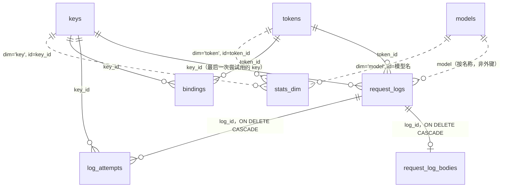

# 数据库设计

xai-router 把全部状态存在一个 SQLite 文件里（`$XR_DATA_DIR/xai-router.db`）：配置、上游密钥、客户端令牌、价格表、请求日志、统计、异步任务的绑定，都在这一个文件中。本文说明每张表的用途、字段、索引、表之间的关系、数据的生命周期和迁移方式，以及背后的设计取舍。

> 状态：**草稿**（v0.4.0 开发中）。本文描述的是 schema v7（v0.3.1）。技术评审和产品评审的结论，以及据此在 v0.4.0 中做的修改，见文末[第 9 节](#9-评审与决定)。

## 1. 约定

| 项目 | 约定 |
|---|---|
| 主键 | 自增整数 `id`（`INTEGER PRIMARY KEY AUTOINCREMENT`，id 不复用）。天然有唯一键的表，直接用它做主键（`models.id` 是模型名，`bindings.resource_id` 是上游资源 id） |
| 时间 | `*_at` 字段都是 **Unix 毫秒**（`INTEGER`，UTC），0 表示"没有"（例如 `expires_at = 0` 表示永不过期）。统计的 `hour` 是该小时起点的 Unix 毫秒（UTC 整点）。按天的图表在查询时按浏览器时区偏移分桶，库里不存时区 |
| 金额 | `*_ticks` 字段都是 `INTEGER` 的 tick：**1 美元 = 10¹⁰ tick**，这是 xAI 自己的计费单位（`cost_in_usd_ticks`）。库里没有浮点金额；API 返回时才换算成美元 |
| 价格 | 文本模型的 token 价格是"每 token 多少 tick"（1 美元/百万 token = 10,000 tick/token）；图片按张，视频按秒 |
| 布尔 | `INTEGER` 0/1 |
| 列表和对象 | JSON 文本（`TEXT`），例如 `aliases`、`allowed_models`、`image_tiers`，空值为 `'[]'` 或 `'{}'` |
| 空字符串 | 文本字段 `NOT NULL DEFAULT ''`，不用 NULL；只有"可能没有"的外部 id（`token_id`、`key_id`）用 NULL |
| 连接 | WAL 模式；1 个写连接 + 只读连接池；`foreign_keys=ON`；`busy_timeout=10s`；`synchronous=NORMAL`；新库 `auto_vacuum=INCREMENTAL` |

## 2. 表一览

| 表 | 用途 | 规模（参考） |
|---|---|---|
| `schema_version` | 当前 schema 版本号（一行） | 1 行 |
| `meta` | 键值配置：运行设置（JSON）、管理员密码 hash、上次模型同步结果等 | 几行 |
| `keys` | 上游 xAI API key 池 | 几到几百 |
| `tokens` | 客户端令牌（应用调用 `/v1/*` 用） | 几到几千 |
| `admin_tokens` | 管理 API 令牌（脚本调用 `/api/v1/*` 用） | 几个 |
| `sessions` | 控制台登录会话 | 几个 |
| `models` | 模型目录和价格表 | 几十 |
| `request_logs` | 每个客户端请求一行：摘要、token 数、费用 | 百万级 |
| `request_log_bodies` | 请求/响应头和正文（与摘要分开存） | 与日志同量，体积占大头 |
| `log_attempts` | 每次上游尝试（一个请求可能换 key 重试多次） | 约等于日志条数 |
| `bindings` | 上游资源（异步视频/图片任务、已存 response、文件、批处理…）与创建它的 key、令牌的绑定 | 随异步任务量 |
| `stats_dim` | 按小时预聚合的统计，分 4 个维度：全部 / 模型 / key / 令牌 | 每小时最多 1 + 模型数 + key 数 + 令牌数 行 |
| `stats_hourly` | v0.1–v0.2 的旧统计表，v3 起已迁到 `stats_dim`，**不再写入**（见第 9 节） | 0 行 |

## 3. 关系图

实线中只有 `request_log_bodies.log_id` 和 `log_attempts.log_id` 是数据库层面的外键（删日志时级联删除）。`request_logs`、`log_attempts`、`bindings` 里的 `key_id`、`token_id` **故意不设外键**：删掉一个 key 或令牌之后，历史日志、统计和账目必须保留，所以日志里同时冗余存了名称（`key_name`、`token_name`）。删除行为见[第 6 节](#6-删除行为)。

## 4. 各表字段

### 4.1 `keys` — 上游密钥

| 字段 | 类型 | 约束/默认 | 含义 |
|---|---|---|---|
| id | INTEGER | PK 自增 | |
| name | TEXT | NOT NULL | 显示名 |
| key | TEXT | NOT NULL UNIQUE | xAI API key 明文（转发时要用，只能存明文；API 和界面只返回掩码） |
| base_url | TEXT | NOT NULL | 上游地址，默认 `https://api.x.ai`，受 SSRF 策略限制 |
| priority | INTEGER | 0 | 优先级组，小的先用 |
| weight | INTEGER | 1 | 组内加权 |
| enabled | INTEGER | 1 | 管理员开关 |
| auto_disabled | INTEGER | 0 | 网关判定失效后自动禁用（与 enabled 分开，恢复不影响管理员意愿） |
| status_reason | TEXT | '' | 自动禁用/冷却的原因 |
| cooldown_until | INTEGER | 0 | 冷却到期时间（ms） |
| max_concurrency / rpm_limit | INTEGER | 0 | 并发、每分钟请求上限，0 = 不限 |
| requests / errors / cost_ticks | INTEGER | 0 | 累计计数器（随日志批量写入一起更新，见 6.3） |
| last_used_at | INTEGER | 0 | |
| last_error | TEXT | '' | 最近一次错误 |
| last_test / last_tested_at | TEXT / INTEGER | '' / 0 | 最近一次检测结果（JSON）和时间 |
| notes | TEXT | '' | 备注 |
| created_at / updated_at | INTEGER | NOT NULL | |

### 4.2 `tokens` — 客户端令牌

| 字段 | 类型 | 约束/默认 | 含义 |
|---|---|---|---|
| id | INTEGER | PK 自增 | |
| name | TEXT | NOT NULL | 不要求唯一 |
| token_hash | TEXT | NOT NULL UNIQUE | 令牌值的 SHA-256（hex）；**不存明文**，令牌值只在创建/重新生成时返回一次 |
| prefix | TEXT | NOT NULL | 令牌值前若干位（`sk-xr-xxxx`），用于在界面上区分 |
| enabled | INTEGER | 1 | |
| quota_ticks | INTEGER | 0 | 额度，0 = 不限 |
| used_ticks | INTEGER | 0 | 已用（计费时累加；"重置用量"会清零） |
| expires_at | INTEGER | 0 | 0 = 永不过期 |
| allowed_models | TEXT | '[]' | 模型白名单（JSON 数组，支持别名和 `grok-4*` 通配），空 = 全部 |
| requests / last_used_at | INTEGER | 0 | 计数器 |
| notes | TEXT | '' | |
| created_at / updated_at | INTEGER | NOT NULL | |

### 4.3 `admin_tokens`、`sessions`

| 表.字段 | 类型 | 含义 |
|---|---|---|
| admin_tokens.id / name / prefix | | 管理 API 令牌（`xra-…`） |
| admin_tokens.token_hash | TEXT UNIQUE | SHA-256，不存明文 |
| admin_tokens.last_used_at / created_at | INTEGER | |
| sessions.token_hash | TEXT PK | 控制台会话令牌的 SHA-256 |
| sessions.created_at / expires_at / last_seen_at | INTEGER | 30 天滑动过期 |

### 4.4 `models` — 模型目录与价格

| 字段 | 类型 | 默认 | 含义 |
|---|---|---|---|
| id | TEXT PK | | 模型名，例如 `grok-4.3` |
| kind | TEXT | | language / image / video / embedding |
| aliases | TEXT | '[]' | 别名（JSON） |
| enabled | INTEGER | 1 | 停用后请求直接拒绝 |
| source | TEXT | 'builtin' | builtin / sync / manual（手动改过的不被同步覆盖） |
| context_length | INTEGER | 0 | |
| input_ticks / cached_ticks / output_ticks / image_input_ticks | INTEGER | 0 | 每 token 价格（tick） |
| long_threshold, long_input_ticks, long_cached_ticks, long_output_ticks | INTEGER | 0 | 长上下文档（prompt ≥ 阈值时整单按此价） |
| image_ticks | INTEGER | 0 | 每张图的基础价（无匹配档位时用最高档） |
| image_tiers | TEXT | '[]' | `[{quality, resolution, ticks}]` |
| video_ticks_per_sec | INTEGER | 0 | 视频每秒基础价 |
| video_tiers | TEXT | '[]' | `[{resolution, ticks}]`（每秒），v5 |
| input_image_ticks / input_video_ticks_per_sec | INTEGER | 0 | 每张输入图 / 每秒输入视频，v5 |
| raw | TEXT | '' | 同步时上游返回的原始 JSON |
| synced_at / updated_at | INTEGER | | |

### 4.5 `request_logs` — 请求日志（摘要）

一个客户端请求一行，无论成功、失败、被网关拒绝还是客户端中途断开。

| 字段 | 类型 | 默认 | 含义 |
|---|---|---|---|
| id | INTEGER PK 自增 | | 也是列表的次排序键 |
| request_id | TEXT | | 网关生成的请求 id（响应头 `X-Request-Id`） |
| created_at | INTEGER | | 请求开始时间（ms） |
| method / path / query | TEXT | | |
| model | TEXT | '' | |
| stream / ws | INTEGER | 0 | 是否流式 / WebSocket |
| status | INTEGER | 0 | 返回给客户端的状态码；499 = 客户端断开 |
| error | TEXT | '' | 错误摘要（≤ 2000 字符） |
| client_ip / user_agent | TEXT | '' | |
| token_id / token_name | INTEGER NULL / TEXT | | 令牌（名称冗余，令牌删除后仍可显示） |
| key_id / key_name | INTEGER NULL / TEXT | | 最后一次尝试用的上游密钥（同上） |
| attempts | INTEGER | 0 | 上游尝试次数 |
| ttfb_ms / latency_ms | INTEGER | 0 | 首包、总耗时 |
| prompt_tokens, completion_tokens, cached_tokens, reasoning_tokens, image_tokens, total_tokens | INTEGER | 0 | 统一口径后的 token 数 |
| images / video_seconds | INTEGER / REAL | 0 | 媒体用量（视频秒数可能有小数，只是用量，不是金额） |
| cost_ticks | INTEGER | 0 | 本请求费用 |
| cost_source | TEXT | 'none' | upstream（上游返回）/ computed（价格表）/ estimated（截断时估算）/ none |
| upstream_id | TEXT | '' | 上游返回的 id（response id、任务 id…） |
| truncated | INTEGER | 0 | 正文是否被截断 |
| extra | TEXT | '' | WebSocket 会话等的附加信息（JSON），v2 |

### 4.6 `request_log_bodies`、`log_attempts`

| 表.字段 | 含义 |
|---|---|
| request_log_bodies.log_id | PK，外键 → request_logs.id，ON DELETE CASCADE |
| req_headers / resp_headers | 头（JSON，Authorization 等已脱敏） |
| req_body / resp_body | 正文（base64 媒体已剥离，超过上限截断；流式为原始 SSE） |
| resp_text / reasoning_text | 拼好的回答全文和推理文本 |
| log_attempts.id | PK 自增 |
| log_attempts.log_id | 外键 → request_logs.id，ON DELETE CASCADE |
| seq, key_id, key_name, status, error, action, ttfb_ms, latency_ms, started_at | 第几次尝试、用的 key、结果、号池采取的动作（retry / cooldown / disable / success / return） |

### 4.7 `bindings` — 资源绑定

| 字段 | 类型 | 含义 |
|---|---|---|
| resource_id | TEXT PK | 上游资源 id |
| kind | TEXT | video / image / deferred / response / file / batch / collection |
| key_id | INTEGER NOT NULL | 后续请求必须用的 key |
| token_id | INTEGER NULL | 只有这个令牌能访问 |
| model | TEXT | |
| billed | INTEGER | 异步任务是否已计费（保证只计一次） |
| price_meta | TEXT | 提交时的计价参数（分辨率、输入图张数…，JSON），v5 |
| created_at / expires_at | INTEGER | 默认 720 小时后过期 |

写入走内存缓存 + 后台顺序落库，请求不等 SQLite 写锁；读取和"只计费一次"的判断先查内存。

### 4.8 `stats_dim` — 小时级预聚合统计

| 字段 | 类型 | 含义 |
|---|---|---|
| dim | TEXT | `all` / `model` / `key` / `token` |
| hour | INTEGER | 小时起点（ms，UTC） |
| id | TEXT | 维度值：`''`（all）、模型名、key id、令牌 id（`'0'` = 无令牌） |
| requests, success, errors | INTEGER | |
| prompt_tokens … total_tokens | INTEGER | |
| cost_ticks | INTEGER | |
| latency_ms_sum | INTEGER | 用于算平均耗时 |
| | | PK (dim, hour, id)，`WITHOUT ROWID` |

每批日志写入时，在**同一个事务**里对 4 个维度做 upsert，所以统计和日志永远一致。

## 5. 索引与它服务的查询

`request_logs` 的列表接口按 `(created_at DESC, id DESC)` 排序，任意筛选组合都要在 300 万条下 p95 < 500ms（实测见 `notes/xai-router-evidence/P1-P2-bench.md`）。分页时先只查 id 再取整行，总数先在 250ms 预算内精确计数，超时则用 `stats_dim` 估算。

| 索引 | 列 | 服务的查询 |
|---|---|---|
| idx_logs_created | (created_at) | 不带筛选的列表、时间范围、深分页、按时间清理 |
| idx_logs_model_f | (model, created_at, key_id, token_id, status, path) | 按模型筛选，以及模型 + 其他维度的组合（覆盖索引，不读宽行） |
| idx_logs_key_f | (key_id, created_at, token_id, model, status, path) | 按 key 筛选及组合 |
| idx_logs_token_f | (token_id, created_at, key_id, model, status, path) | 按令牌筛选及组合 |
| idx_logs_status | (status, created_at) | 精确状态码（例如 429） |
| idx_logs_ok | ((成功表达式), created_at) | status=success / error |
| idx_logs_class | ((status/100), created_at) | 4xx / 5xx |
| idx_logs_path | (path, created_at) | 路径前缀 |
| idx_logs_reqid | (request_id) | 按请求 id 搜索 |
| idx_logs_upstream | (upstream_id) | 按上游 id 搜索 |
| idx_logs_errsearch | (created_at, id, error, model, key_id, token_id, status, path) WHERE error <> '' | 错误文本搜索（只扫失败请求，覆盖其他筛选列） |
| idx_attempts_log | log_attempts(log_id) | 日志详情取尝试记录；级联删除 |
| idx_bindings_expires | bindings(expires_at) | 清理过期绑定 |
| 各表 UNIQUE | keys.key、tokens.token_hash、admin_tokens.token_hash | 导入去重、按 hash 鉴权 |

统计查询只读 `stats_dim` 的主键范围（`dim = ? AND hour >= ?`），与日志量无关。

## 6. 删除行为

| 删除对象 | 日志 | 尝试记录 | 统计 | 绑定 |
|---|---|---|---|---|
| 一条日志（清理） | — | 级联删除 | **保留**（统计不随日志删除） | 不受影响 |
| 上游密钥 | 保留，`key_id` 指向已删除的 id，显示冗余的 `key_name` | 同左 | 保留（显示为"#id（已删除）"） | 保留到过期；绑定到这个 key 的资源返回 503 `upstream_key_unavailable` |
| 客户端令牌 | 保留，同上 | — | 保留 | 保留到过期；资源只属于原令牌，其他令牌访问是 404 |

已知问题：删除令牌后，`SUM(tokens.used_ticks)` 不再等于日志费用之和；"重置用量"也会造成同样的差额。见第 9 节。

### 6.3 冗余字段与对账

以下字段是冗余的，都在写日志的同一事务里更新，用于快速显示：`keys.requests/errors/cost_ticks`、`tokens.requests/used_ticks`、`stats_dim`、日志里的 `key_name`/`token_name`。对账关系是：日志费用之和 = 统计费用之和 = key 花费之和 = 令牌已用之和（排除被删除和被重置的令牌）。`tokens.used_ticks` 同时是额度判断的依据（启动时从库里加载，运行时由额度模块在内存中预扣和结算）。

## 7. 数据生命周期

| 数据 | 保留 | 由谁清理 |
|---|---|---|
| 请求日志（含正文、尝试记录） | 默认 30 天（`log_retention_days`，0 = 永久） | 后台清理任务每小时一次，每批 1000 行，批间让出写锁；也可在控制台手动按日期清理（后台任务，有进度） |
| 统计 `stats_dim` | **永久**（每小时最多几十行，一年约几十万行） | 不清理 |
| 绑定 | 默认 720 小时（`task_binding_ttl_hours`） | 后台清理任务 |
| 会话 | 30 天滑动过期 | 后台清理任务 |
| 上游密钥、令牌、模型、设置 | 永久，直到手动删除 | — |

磁盘空间：新库是 `auto_vacuum=INCREMENTAL`，删除后的空闲页可以回收；v0.3 之前创建的库需要在"数据与存储"页执行一次"压缩"（完整 VACUUM）转换。

## 8. 迁移

- 版本号存在 `schema_version`（一行）。启动时按顺序执行 `internal/store/db.go` 的 `migrations[v:]`，**每个版本在一个事务里**执行并更新版本号；失败则整体回滚，下次启动重试。
- 只加不删：已发布的迁移不再修改；结构变更都通过新版本完成。
- 大表上的改动（建索引）先建新的再删旧的，避免中间没有索引。

| 版本 | 发布 | 内容 |
|---|---|---|
| v1 | v0.1.0 | 初始 schema：meta、keys、tokens、admin_tokens、sessions、models、request_logs、request_log_bodies、log_attempts、bindings、stats_hourly |
| v2 | v0.2.0 | 日志加 `ws`、`extra`（WebSocket 会话） |
| v3 | v0.3.0 | 新统计表 `stats_dim`，从 `stats_hourly` 回填后清空旧表；日志加成功/失败、状态类别、路径、上游 id 索引 |
| v4 | v0.3.0 | 失败请求的部分索引（错误文本搜索） |
| v5 | v0.3.0 | 模型加 `video_tiers`、`input_image_ticks`、`input_video_ticks_per_sec`；绑定加 `price_meta` |
| v6 | v0.3.0 | 错误文本搜索的覆盖索引 `idx_logs_errsearch`，替换 v4 的索引 |
| v7 | v0.3.0 | 模型、key、令牌索引改为覆盖其他筛选列（`*_f`），替换旧的单列索引 |

升级测试：`store.TestUpgradeFromV010Schema` 用 v0.1.0 的 schema 和数据升级到最新版本并核对数据。

## 9. 评审与决定

（待补：独立技术评审结论、产品评审意见、v0.4.0 的修改和取舍。）

## 10. 关键设计取舍

**金额用 int64 tick。** xAI 自己按 tick 计费（`cost_in_usd_ticks`），直接存同一单位，上游返回的数值原样入库，不经过任何换算；整数加法没有舍入误差，"日志之和 = 令牌已用 = key 花费"可以精确到 tick。int64 最大约 9.2×10¹⁸ tick ≈ 9.2 亿美元，远超单个网关的累计花费。只在 API 输出时换算成美元。

**令牌只存 hash。** 客户端令牌和管理 API 令牌都只存 SHA-256；鉴权时对请求里的令牌算 hash 再查唯一索引，常量时间比较。库文件泄露也拿不到可用的令牌；代价是令牌值只能在创建时看到一次，丢了只能重新生成。上游 xAI key 必须用明文转发，所以只能存明文，接口和界面只返回掩码。

**为什么用 SQLite。** 目标是"小生产"：单机、单容器、20 个左右并发、几百万条日志。SQLite（WAL）在这个规模下读写都够快（实测 300 万条日志下列表 p95 < 200ms、统计 < 40ms、20 并发转发的网关额外延迟 p99 约 2ms），而且零运维：一个文件，备份就是复制文件，不需要另起数据库服务。写入集中在一个连接上，日志批量写、按批清理，避免写锁争用。如果以后要多实例部署，需要换成 MySQL/Postgres，迁移难度见第 9 节的评审。

**日志摘要和正文分开存。** `request_logs` 只放列表和筛选需要的短字段，正文（可能几百 KB）在 `request_log_bodies`。这样列表查询、索引扫描、统计都不碰大字段；详情页才按主键取正文。关闭"记录正文"时只写摘要。

**统计做小时级预聚合。** 概览、趋势、按模型/key/令牌拆分如果每次扫日志，300 万条下要几秒，而且日志过期删除后统计就没了。`stats_dim` 每小时每个维度一行，写日志时在同一事务里 upsert，查询只读几百到几千行；统计永久保留，不受日志保留天数影响。按天的图表从小时数据按查看者时区汇总。代价是只能按这 4 个维度和小时粒度看，跨维度组合（例如"某令牌在某模型上"）需要查日志。
